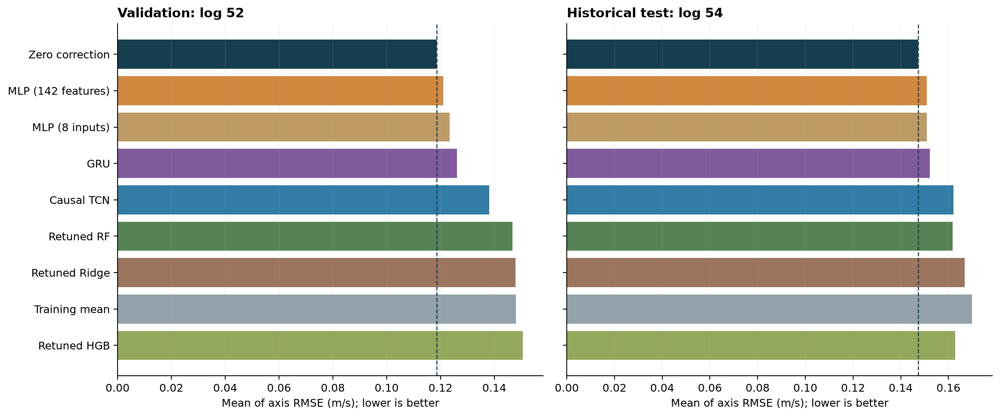
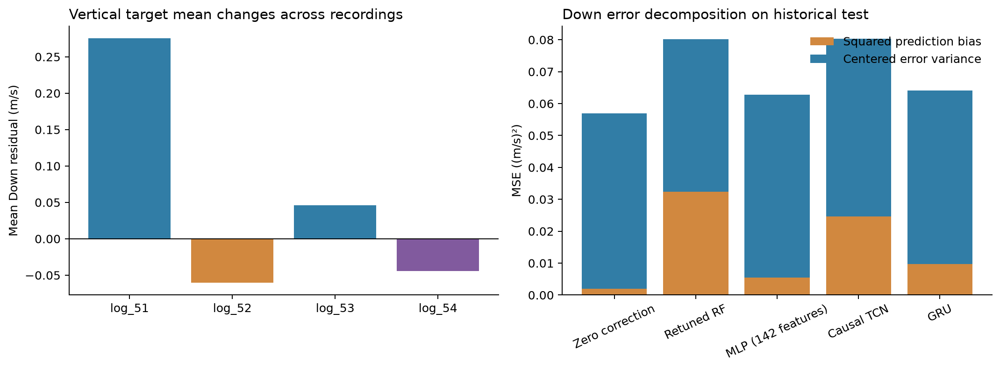
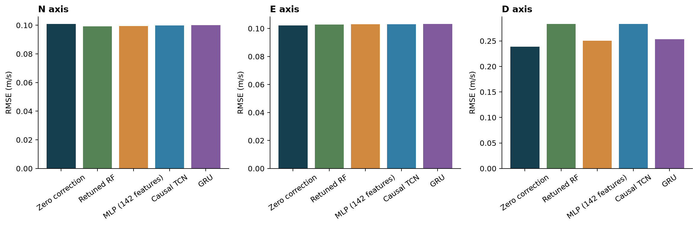
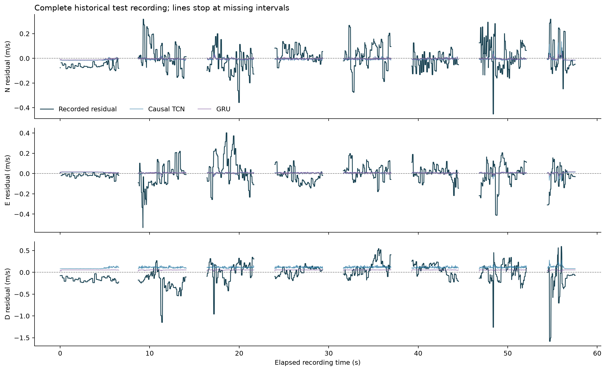
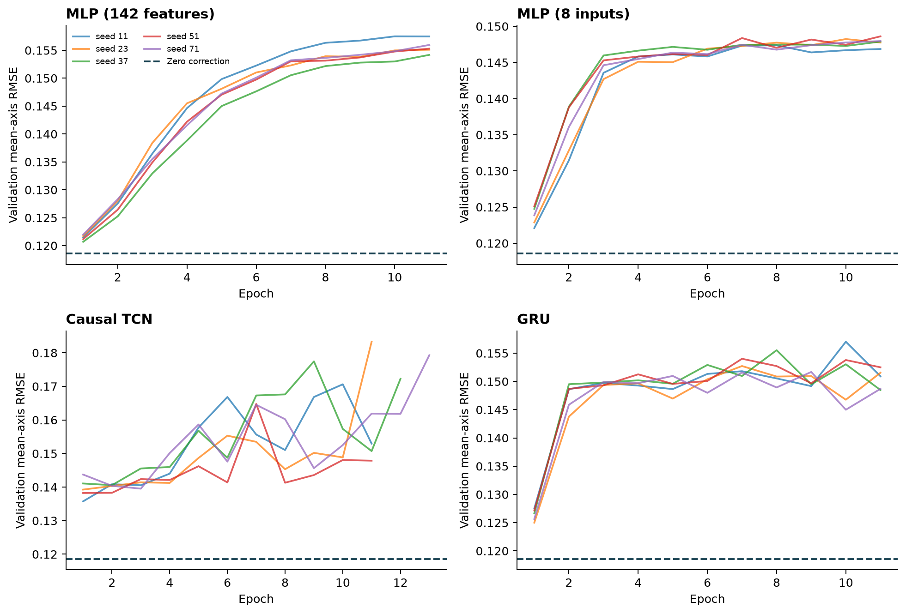
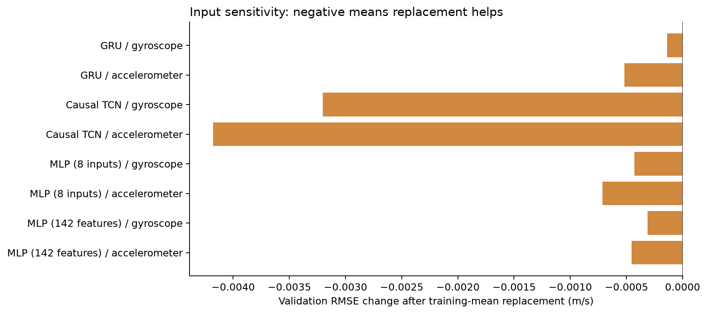

# Phase 2: causal IMU residual learning


## Results

| model | rmse_mean | mae_mean | r2_mean | rmse_N | rmse_E | rmse_D | improvement_pct_vs_zero |
| --- | --- | --- | --- | --- | --- | --- | --- |
| Zero correction | 0.147245 | 0.106464 | -0.012706 | 0.100908 | 0.102152 | 0.238673 | 0.000000 |
| Training mean | 0.169940 | 0.126798 | -0.238542 | 0.100898 | 0.102441 | 0.306480 | -15.413058 |
| Retuned Ridge | 0.166824 | 0.124980 | -0.198648 | 0.098564 | 0.102814 | 0.299095 | -13.297373 |
| Retuned RF | 0.161762 | 0.118533 | -0.147191 | 0.099205 | 0.102894 | 0.283188 | -9.859397 |
| Retuned HGB | 0.162747 | 0.120979 | -0.156559 | 0.099461 | 0.102376 | 0.286406 | -10.528579 |
| MLP (142 features) | 0.151000 | 0.109947 | -0.043872 | 0.099368 | 0.103067 | 0.250565 | -2.550385 |
| MLP (8 inputs) | 0.150897 | 0.108965 | -0.044867 | 0.100662 | 0.102327 | 0.249702 | -2.480577 |
| Causal TCN | 0.162051 | 0.117733 | -0.152433 | 0.099808 | 0.103021 | 0.283325 | -10.055843 |
| GRU | 0.152194 | 0.110731 | -0.057665 | 0.099992 | 0.103261 | 0.253328 | -3.361060 |
| Validation-selected policy | 0.147245 | 0.106464 | -0.012706 | 0.100908 | 0.102152 | 0.238673 | 0.000000 |


## Finding

Validation selected zero correction. Its historical-test RMSE is 0.147245 m/s (+0.00% improvement versus zero correction). The lowest descriptive DL test RMSE belongs to MLP (8 inputs) (0.150897 m/s); this ranking was not used to select the policy.


## What was tested

24 classical configurations and 26 neural configurations were evaluated on validation log 52. Selected neural configurations were repeated across 5 fixed seeds (42 neural fits in total). Train logs are 51 and 53. Test log 54 has 8,306 rows and was already inspected during Phase 1. Neural architecture rows use the mean prediction of all prescribed seeds; individual seed scores remain in the CSV.


## What the prediction means

The target is recorded PX4 velocity minus recorded GPS velocity. A positive predicted residual is subtracted from PX4. The corrected error is exactly target minus prediction, so correction RMSE and residual RMSE are the same calculation on identical rows. No trajectory, filter replay or genuine GNSS outage is evaluated.


## Why learning is difficult

The Down target mean is positive in both training recordings and negative in validation and test. This directly establishes distribution shift, but not its physical cause. Missing attitude/heading, source synchronization and estimator state limit what body-frame IMU readings can tell us about NED residuals. Label autocorrelation does not establish predictability from IMU history. Model outputs can reproduce training offsets instead of correcting new recordings.


## Validation and leakage safeguards

Scaling is fit on unique training rows. Input windows contain only present/past IMU samples within one continuous segment; gaps above 50 ms reset history. Startup uses explicit masks. GPS, PX4 velocity, absolute time and true residual history are excluded from predictors. HGB random internal validation is disabled; all model selection uses whole log 52. A decision manifest is written before historical-test scoring.


## Fair comparison and remaining limits

The feature MLP and retuned classical methods share 142 engineered features. The raw MLP controls for instantaneous nonlinear modeling. Temporal models test 1, 100, 200 and 400 sample histories and selected dt/Huber variants. The raw-MLP control has two candidates; main model families have eight. Neural training uses stride-5 endpoints, classical training uses all rows, and early stopping monitors stride-5 validation endpoints before full-validation selection. Longer neural contexts exceed the historical feature horizon; those differences cannot be attributed purely to architecture. Five-seed ensembles also have a greater inference cost than one model. Equal trial counts do not imply equal computational budgets.


## How to read uncertainty

Per-seed scores describe optimizer variability. Paired block intervals resample contiguous blocks within segments, using 100/200/400-row block lengths. They are conditional sensitivity intervals for this recording, not population-level confidence intervals across independent flights. Four logs from one session cannot support a strong deployment claim.


## How to read explanations

Input sensitivity replaces a sensor group by its training mean in normalized coordinates for the first fixed seed, on validation only. A negative delta means the replacement improved validation error. This is a perturbation diagnostic, not causal importance; replacing channels creates unusual inputs and may break relationships between axes and magnitudes. Error decomposition separates squared bias from centered variance without attributing either to downwash or sensor physics.


## What is complete

The project includes trained checkpoints, scalers and schemas, bounded searches, replicated neural experiments, aligned prediction exports, causal/streaming correctness tests, conditional uncertainty analysis and local CPU timing. Original Phase 1 reports, presentation, models and metrics are preserved. Current-date commits describe actual changes under the configured Git author.


## Next scientific milestone

Acquire independent recording sessions and recover original ULogs, extraction scripts, source measurement timestamps, coordinate conventions and fusion configuration. Evaluate a verified GNSS outage while retaining independent reference measurements for scoring. Until then, this is a complete offline residual benchmark, not a deployed navigation correction system.


## Figures














## Reproduce

From the repository root, install requirements-phase2-lock.txt, then reproduce the included checkpoint evaluation:

```bash

python -m src.dl.experiment --stage evaluate

python -m src.dl.explain

python -m src.dl.report

```

Existing evaluated runs cannot be retuned in place. For fresh training, copy the configuration with a new name and pass --config. See docs/phase2_usage.md for commands. The commands above use the default phase2_v2 run.


## Research context

- Bai et al., temporal convolutional networks: https://arxiv.org/abs/1803.01271

- Cioffi et al., drone inertial odometry (uses thrust unavailable here): https://arxiv.org/abs/2210.15287
